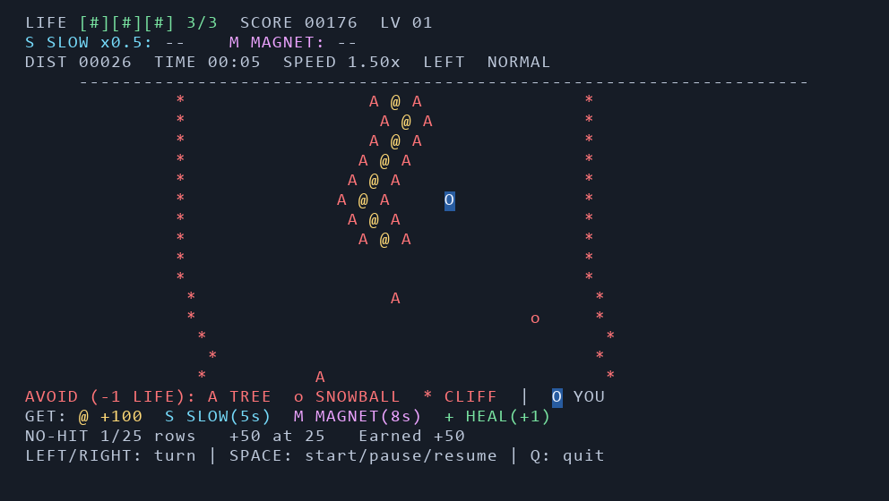

# w11 ASCIIスキーゲーム

## ゲームの概要

授業で配布されたASCIIスキーゲームをベースにした、ターミナル向けのスキーゲームです。左右に進路を切り替えて木・雪玉・崖を避け、コインやアイテムを拾いながら自己ベストを目指します。

## 動作環境

- 確認環境はWindows、Python 3.14.5、`windows-curses` です。
- VS Codeの統合ターミナルなど、キー入力を受け付ける64列×21行以上の端末が必要です。

## インストール方法

VS Codeでゲームのフォルダーを開き、**「ターミナル」→「新しいターミナル」**を選びます。最初の1回だけ、Windows用の描画ライブラリをインストールします。

```powershell
py -m pip install windows-curses
```

## 起動方法

`w11_ski_demo.py` のあるフォルダーで起動します。

```powershell
py w11_ski_demo.py
```

`py` が使えない環境では `python` に読み替えてください。キー入力が効かない場合は、ターミナルをクリックしてから操作してください。

## 操作方法

| キー | 操作 |
| --- | --- |
| `N` / `H` | 開始前に通常（NORMAL）/ 難しい（HARD）を選ぶ |
| `Space` | 開始・一時停止・再開 |
| `←` / `→` | 滑る方向を左・右に切り替える |
| `R` | ゲームオーバー後に同じ難易度で再挑戦 |
| `Q` | 終了 |

プレイヤーは `O` です。コースが1行進むたび、選んだ方向へ1マス滑ります。中央付近を保ちたいときは左右に切り返します。100行進むごとにレベルが上がり、コースが速く流れ、幅も狭くなります。

## 追加・改良した機能

### ライフ・被弾演出・動く雪玉

赤い `A`（木）、`o`（左右に動く雪玉）、`*`（崖）に当たるとライフを1失います。ライフは3から始まり、残りは画面左上に表示されます。被弾時は画面が揺れ、1.5秒間無敵になります。ライフが0になるとゲームオーバーです。

### アイテムと取得範囲

| 記号 | 色 | 取得時の効果 |
| --- | --- | --- |
| `@` | 黄 | コイン1枚につき100点 |
| `S` | 水色 | 5秒間、滑走と雪玉の速度が半分 |
| `M` | 紫 | 8秒間、縦と横の距離の合計が4マス以内のコインを自動回収 |
| `+` | 緑 | ライフを1回復（最大3） |

通常は、プレイヤーと同じ行の中央・左1マス・右1マスでコインやアイテムを拾えます。画面下の凡例で、避ける障害物と拾えるアイテムを確認できます。

### コイン列とスラローム

コインは縦や斜めに並び、木のスラロームでは2本の木の間に1枚あります。ときどき10〜15行連続のスラロームが現れるので、コイン列を目印に切り返しましょう。

### 無傷ボーナスと自己ベスト

- 1行滑るごとに **1点**、コイン1枚につき **100点**。
- ライフを失わずに **25行** 滑るごとに **50点**。被弾すると次のボーナスまでのカウントがリセットされます。
- ゲームオーバー後は、今回のスコア・滑走距離・コイン枚数と、同じ難易度の項目別自己ベストを表示します。Windowsでは記録を `%LOCALAPPDATA%\w11_SkiGame\records.sqlite3` に保存します。

### 描画と入力の更新

描画とキー入力の目標更新回数を30 FPSから60 FPSに引き上げました。各フレームの処理時間を含めて、次の更新までの待ち時間を調整します。

## スクリーンショット



プレイ中のターミナル出力を画像化した例です。色合いは端末の配色によって変わります。

## 既知の問題・制限事項

- 端末が64列×21行未満だとプレイできません。通常のプレイ中に端末サイズを変更すると、そのプレイはリセットされます。
- 60 FPSは目標値で、実際の更新頻度は端末や処理負荷によって変わります。
- 記録はゲームオーバー時にローカルへ保存されます。保存先に書き込めない場合は、リザルトに `Best records unavailable` と表示されます。

## クレジット

- ベースゲームはプログラミング演習1の第11回配布教材「ASCIIスキーゲーム（学生版）」です。
- 改良コードの実装とREADMEの作成にOpenAI Codexを利用しました。

## 課題提出用のGit Bundle

提出用のBundleが必要な場合は、変更をコミットしてから、ゲームのフォルダーで次のコマンドを実行します。`学籍番号` は自分の番号に置き換えてください。Bundleは1つ上のフォルダーに作成されます。

```powershell
git status
git bundle create ../w11_学籍番号.bundle --all
```
